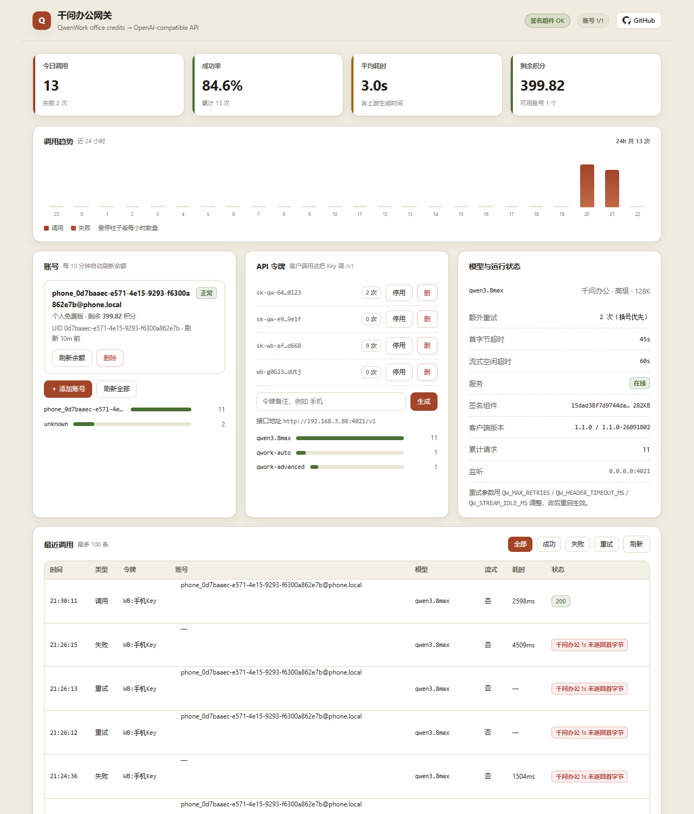

# QwenWork Gateway · 千问办公网关

**把千问办公（QwenWork）账号里的办公积分，变成一个带管理后台的 OpenAI 兼容 API。**
可直接接进 **Claude Code / Codex / Cherry Studio / Cline**，也能作为 **new-api / one-api** 的上游渠道。

[](LICENSE)


> Turn QwenWork (千问办公) office credits into an OpenAI-compatible API gateway.
> Works with Claude Code, Codex, Cherry Studio, Cline, or as an upstream channel of new-api / one-api.
> Multi-account pool, quota dashboard, timeout-retry with failover — **zero npm dependencies**.



## 为什么用它 / Why

- **把闲置积分变成 API**：千问办公送的办公积分只能在官方客户端里用，这个项目让它能被任何 OpenAI 客户端调用。
- **不用装客户端**：签名组件直接从官方 Linux 安装包解包提取，服务器（Linux / NAS / 软路由）就能跑。
- **自带后台**：授权、余额、令牌、24 小时调用趋势、重试记录都在一个看板里。
- **稳**：首字节超时、流式空闲超时、换号重试，避免上游偶发卡死拖挂客户端。

---

## AI 一键安装 / AI one-click install

把下面这段提示词发给你的 AI 助手（Claude Code / Codex / Cursor / Hermes 等），它会自动完成部署：

```text
请帮我部署 qwenwork-gateway（https://github.com/jianhx189/qwenwork-gateway）：
1. 克隆仓库并进入目录，确认 Node.js >= 20。
2. 按 README「方式 A」下载千问办公 Linux 安装包，dpkg-deb 解包，
   把 resources/qoder-auth-wasm/qoder_auth_wasm_bg.wasm 复制到项目根目录，然后删掉安装包和解包目录。
3. 用 node server.mjs 启动（或 pm2 start ecosystem.config.cjs），确认 4021 端口在监听。
4. 把后台地址（/admin）和 data/admin_token.txt 里的管理令牌给我，
   提醒我去后台点「添加账号」完成千问办公授权。
```

---

## 它能做什么 / What it does

| 能力 | 说明 |
|---|---|
| OpenAI 兼容 | `GET /v1/models`、`POST /v1/chat/completions`（流式 / 非流式） |
| 多账号池 | 授权多个千问办公账号，按剩余积分自动选号 |
| 自动续期 | `refresh_token` 到期自动换，无需反复扫码 |
| 余额看板 | 剩余 / 已用积分、套餐、刷新时间，10 分钟自动更新 |
| 用量图表 | 今日调用、成功率、平均耗时、24 小时趋势、按模型/账号分布 |
| API 令牌 | 后台一键生成 `sk-qw-*`，可停用、可删除、带调用计数 |
| 调用日志 | 时间、模型、账号、耗时、流式、错误，最近 100 条 |
| 模型别名 | 对外只暴露 `qwen3.8max`，内部映射到千问办公「高级」档，可改 |

**不需要安装千问办公桌面 App**。唯一必须从官方客户端提取的是 `qoder_auth_wasm_bg.wasm`（签名组件），用官方 Linux 安装包解包即可拿到，见下文。

---

## 快速开始 / Quick start

### 1. 准备环境

- Node.js **20+**（用了原生 `fetch` / `AbortSignal.any` / `WebAssembly`）
- 无需 `npm install`，**零第三方依赖**

### 2. 提取签名组件（一次性）

方式 A：从官方 Linux 安装包解包（推荐，不用装 App）

```bash
curl -LO https://assets.qwenwork.cn/release/latest/qwenworkcn-linux-amd64.deb
dpkg-deb -x qwenworkcn-linux-amd64.deb unpack
cp unpack/opt/apps/QwenWorkCN/resources/qoder-auth-wasm/qoder_auth_wasm_bg.wasm ./
rm -rf unpack qwenworkcn-linux-amd64.deb
```

方式 B：从已安装的客户端复制

```text
<客户端目录>/resources/qoder-auth-wasm/qoder_auth_wasm_bg.wasm
```

也可以用环境变量指定路径：`QWENWORK_WASM_PATH=/path/to/qoder_auth_wasm_bg.wasm`

版本号默认取 `1.1.0-26091802`，可用 `QWENWORK_CLIENT_VERSION` / `QWENWORK_RELEASE_VERSION` 覆盖。

### 3. 启动

```bash
node server.mjs            # 默认监听 4021
# 或 PM2
pm2 start ecosystem.config.cjs
```

### 4. 打开后台

```
http://<host>:4021/admin?token=<见 data/admin_token.txt>
```

首次启动会自动生成管理令牌并写入 `data/admin_token.txt`，也可用 `ADMIN_TOKEN` 环境变量固定。

### 5. 授权账号

后台点 **＋ 添加账号** → 复制链接到浏览器 → 登录千问办公账号并确认 → 回到后台即看到余额。

### 6. 调用

```bash
curl http://<host>:4021/v1/chat/completions \
  -H "Authorization: Bearer sk-qw-你的令牌" \
  -H "Content-Type: application/json" \
  -d '{"model":"qwen3.8max","messages":[{"role":"user","content":"你好"}]}'
```

---

## 配置 / Configuration

全部通过环境变量：

| 变量 | 默认 | 说明 |
|---|---|---|
| `PORT` | `4021` | 监听端口 |
| `ADMIN_TOKEN` | 自动生成 | 后台管理令牌 |
| `QWENWORK_WASM_PATH` | `./qoder_auth_wasm_bg.wasm` | 签名组件路径 |
| `QWENWORK_CLIENT_VERSION` | `1.1.0` | 客户端版本号 |
| `QWENWORK_RELEASE_VERSION` | `1.1.0-26091802` | 发布版本号 |
| `REFRESH_MS` | `600000` | 余额刷新间隔（毫秒） |
| `QW_MAX_RETRIES` | `2` | 首次之外的额外尝试次数 |
| `QW_HEADER_TIMEOUT_MS` | `45000` | 首字节超时（毫秒） |
| `QW_STREAM_IDLE_MS` | `60000` | 流式空闲超时（毫秒） |

### 超时与重试

- **首字节超时**：默认 45s 未返回响应头即中断本次请求。
- **流式空闲超时**：默认 60s 无新帧即断开。
- **自动换号重试**：超时、5xx、429、401 会触发重试，优先换用其他账号；只有一个账号时同号重试。
  401 会先刷新令牌再试，429 会把该账号标记为积分不足。
- **已开始输出后不再重试**，避免客户端收到重复内容。
- 响应头带 `X-Gateway-Attempts`（第几次成功），后台日志里能看到「重试」记录。

模型映射在 `server.mjs` 顶部：

```js
const PUBLIC_MODELS = { 'qwen3.8max': 'qwork-advanced' }
```

想同时暴露「基础」档，加一行 `'qwen3.8': 'qwork-auto'` 即可。

---

## 文件说明 / Layout

```
server.mjs              服务入口（HTTP 路由 / 鉴权 / 账号池 / 日志）
admin.html              管理后台（单文件，无前端依赖）
lib/wasm.mjs            WASM 签名组件胶水（上游原版）
lib/chat.mjs            OpenAI 请求 → 千问办公请求转换 + 流式解析
lib/account.mjs         OAuth 设备授权 / 续期 / 余额
lib/constants.mjs       上游地址、模型档位、客户端头
lib/errors.mjs          错误归一化
lib/runtime.mjs         签名组件发现与版本读取
ecosystem.config.cjs    PM2 配置
data/                   运行时生成（账号、令牌、日志），已在 .gitignore
```

`lib/` 下 5 个核心文件来自上游插件，未改动协议逻辑；`server.mjs` 与 `admin.html` 是本项目的独立服务层和后台。

---

## 注意 / Notes & risks

- **非官方项目**。上游登录、加密、计费协议随时可能变化，不保证长期可用。
- 调用会**真实消耗你账号的办公积分**，余额以后台显示为准。
- 签名组件来自官方客户端，**本仓库不分发该文件**，需要你自己提取（见上）。
- 账号令牌保存在 `data/state.json`，请自行保护好部署目录。

---

## 致谢 / Credits

协议实现基于 [tianyn1990/qwenwork-magpie](https://github.com/tianyn1990/qwenwork-magpie)（MIT）的 `lib/`。
签名组件为千问办公官方客户端所有，本项目不附带、不分发。
详见 `THIRD_PARTY_NOTICES.md`。

## License

MIT（见 `LICENSE`）。
